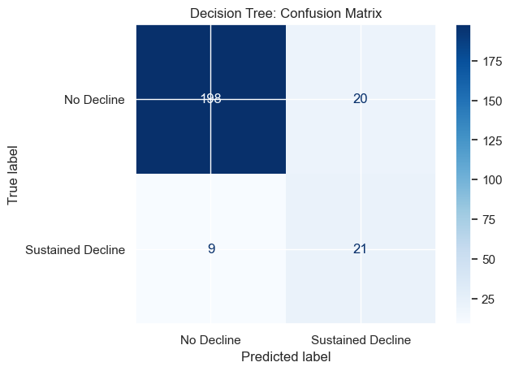
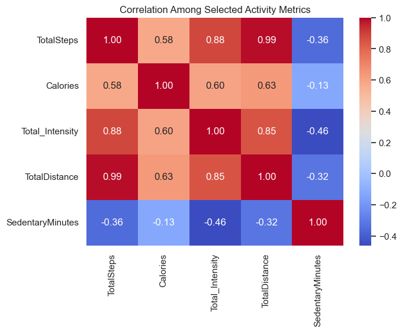

# Workout Burnout Early Warning

Can a fitness tracker warn you before you burn out? This project uses public Fitbit data to predict **sustained declines in activity**, days when a person's 7-day average steps drop below 70% of their own normal, using only information from *before* those days, so the model works like a real early warning.

Final project for ISDS 7075 in the LSU M.S. in Analytics (Group 10, Summer 2026). Python · pandas · scikit-learn · seaborn.



## Results

| Model | Accuracy | Precision | Recall | F1 |
|---|---|---|---|---|
| **Decision Tree** | 0.883 | 0.512 | **0.700** | **0.592** |
| Logistic Regression | 0.855 | 0.440 | 0.733 | 0.550 |
| Random Forest | 0.915 | 0.800 | 0.400 | 0.533 |

Evaluated on 248 days from 7 people the models never saw (split by person, not by row, so a model can't memorize someone's habits).

- **Accuracy alone would have picked the wrong model.** Random Forest had the highest accuracy but caught only 12 of 30 decline cases. The Decision Tree caught 21.
- The most important signal was **prior 7-day workout intensity** (importance 0.65), followed by change in sedentary minutes and step trend.
- Tuning the tree with GridSearchCV scored slightly lower on the test set (F1 0.575), so we kept the simpler model.

> **Reproducibility note:** the table above comes from the saved notebook outputs. Re-running the notebook with scikit-learn 1.9 gives the same Decision Tree and Logistic Regression scores, but the Random Forest comes out at F1 0.593 (precision 0.667, recall 0.533), roughly tied with the Decision Tree. Random Forest results can change between scikit-learn versions even with a fixed `random_state`.

## What's here

| Path | What it is |
|---|---|
| `notebooks/01_data_prep_and_eda.ipynb` | Cleaning, joining daily activity, hourly intensity, and sleep; exploratory charts |
| `notebooks/02_burnout_model.ipynb` | Target definition, feature engineering, model comparison, tuning |
| `data/` | Cleaned CSVs (35 participants, March–May 2016) |
| `report/Final_Report_Part2_Group10.pdf` | Written report |
| `images/` | Key charts from the notebooks |

## How we built it

1. Rolled hourly intensity up to daily totals and left-joined it with daily activity and sleep, keeping all 1,373 person-days.
2. Dropped a duplicate measure (two distance columns were 0.99 correlated) and kept sleep out of the final model because only 24 of 35 people logged it.
3. Built three backward-looking features: prior 7-day intensity, change in sedentary minutes, and step trend.
4. Split 28 people for training and 7 for testing with `GroupShuffleSplit`.
5. Compared Logistic Regression, Decision Tree, and Random Forest with balanced class weights; judged them on recall and F1, since missing a decline matters more than a false alarm.



## Run it

```bash
pip install -r requirements.txt
jupyter notebook notebooks/
```

The notebooks read the CSVs from `data/`.

## Data and credit

Cleaned from the public [FitBit Fitness Tracker Data](https://www.kaggle.com/datasets/arashnic/fitbit) on Kaggle (CC0), collected through Amazon Mechanical Turk in 2016. Group project by LSU MSA Group 10 (ISDS 7075): Tyra Ferguson, Ana De La Concepion, and Richard Rechtorovic.
